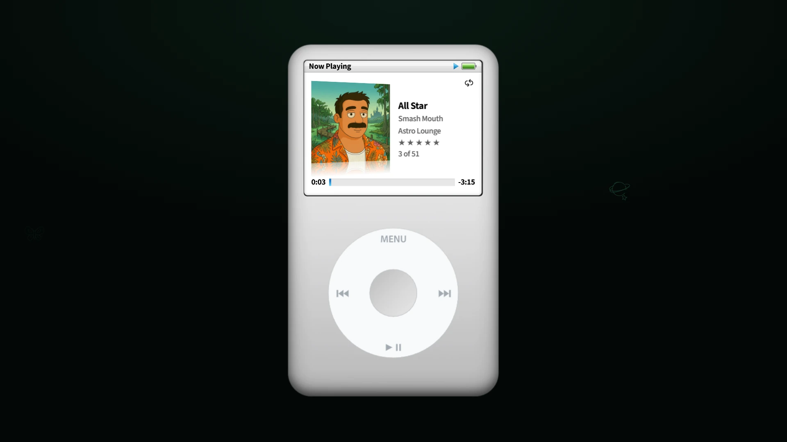
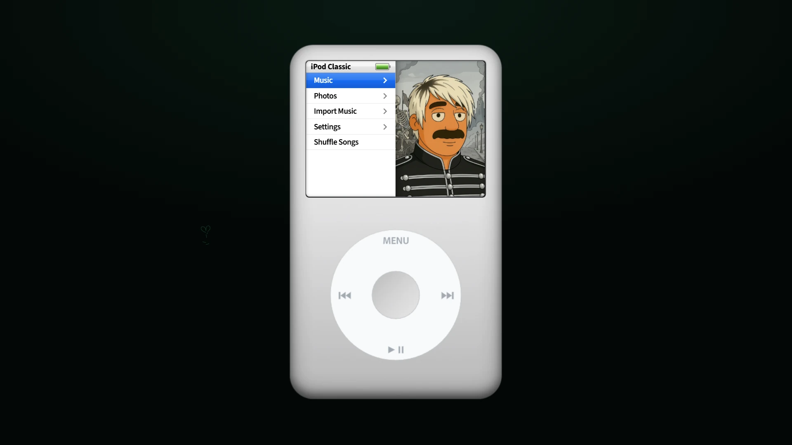

# iPod Classic

A click-wheel music player. Play it in your browser, or install it as a desktop widget on Windows.

**[Download for Windows](https://github.com/mitchivin/ipod-classic/releases/latest) · [Open live demo](https://mitchivindesign.github.io/ipod-classic/) · [Explore in DoodleDev](https://doodledev.app/builds/#ipod-classic)**

Current release: **0.0.28**. iPod Classic is free to use.

## Features

- **Click wheel.** Scroll, select and control playback with the circular wheel.
- **Music library.** Browse artists, albums, songs and playlists.
- **Now Playing.** Album artwork, track details and playback progress.
- **Import your music.** Add songs from your own computer or phone.
- **Desktop widget.** On Windows it's just the device on your desktop: a see-through window you drag anywhere, with a tray icon and Always on Top.
- **Live demo.** The browser version comes with a demo library and works on desktop and phone.

## Get started

### Windows desktop widget

1. Download the **Setup installer** from [Releases](https://github.com/mitchivin/ipod-classic/releases/latest) and run it.
2. The installer isn't signed, so Windows may show "Windows protected your PC". Click **More info**, then **Run anyway**.
3. The widget starts with an empty library. Choose **Import Music** to add your songs.

### Browser

1. Open the [iPod Classic live demo](https://mitchivindesign.github.io/ipod-classic/).
2. Browse the library and choose a track.
3. Use the click wheel to control playback.

This repository contains public product information and release downloads. The application source is not published here.

## Related

- [DoodleDev](https://doodledev.app/)
- [Mi Boy Color](https://github.com/mitchivin/miboy)
- [MitchIvin XP](https://mitchivin.com/)

## About

Built by [Mitch Ivin](https://mitchivin.com/) in [DoodleDev](https://doodledev.app/).

iPod Classic is an independent creative project and is not affiliated with Apple.

Screenshots captured at 1920 × 1080.
